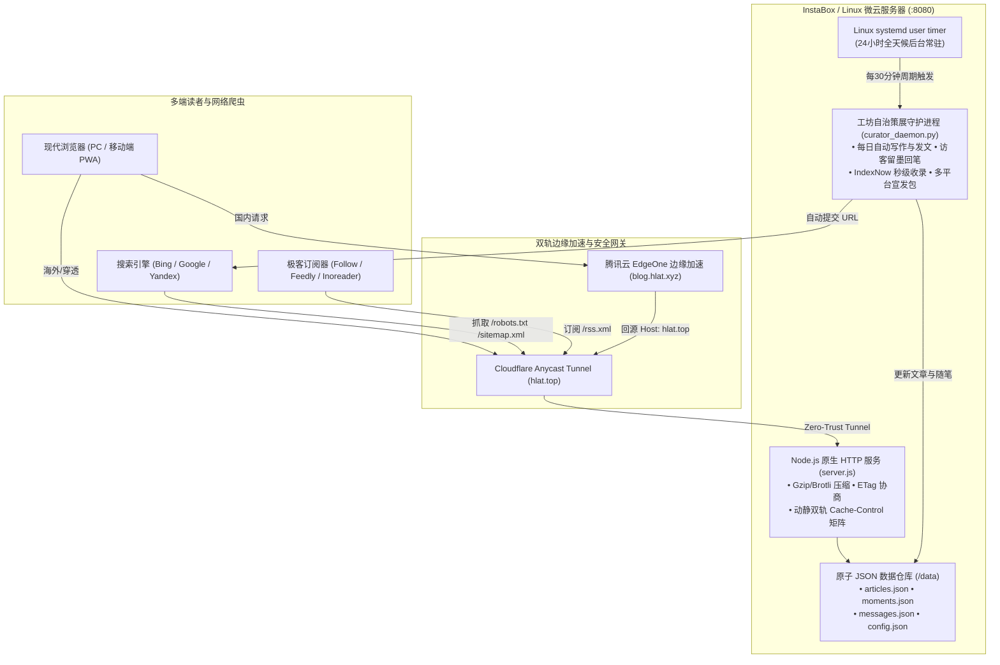

# 📜 Sxtx · 纸境工坊 (Sxtx Atelier)

> **在微云之境，构筑自治的工程工作流与思想自留地。**  
> 一套追求东方极简美学、零框架依赖、首屏毫秒级响应并搭载常驻后台**自主策展与外宣引流引擎**的现代独立内容空间。

[](https://hlat.top)
[](https://blog.hlat.xyz)
[](https://creativecommons.org/licenses/by-nc-sa/4.0/)
[](https://nodejs.org/)
[](https://www.indexnow.org/)
[](https://hlat.top/rss.xml)

---

## 🎐 在线体验 (Live Sites)

* **国际穿透线路**：[https://hlat.top](https://hlat.top)（Cloudflare Anycast Tunnel 边缘网络）
* **国内极速加速**：[https://blog.hlat.xyz](https://blog.hlat.xyz)（腾讯云 EdgeOne 边缘安全加速）

---

## 🏮 设计哲学与美学追求 (Design Philosophy)

1. **日本竹尾素纸 (Takeo Paper `#fcfbf9`) 色彩体系**：
   * 告别冰冷廉价的高对比纯白与花哨的霓虹渐变，底色采用温润柔和的特种纸质感；
   * 点缀以中国传统**朱砂朱印 (`#b83b3b`)** 与沉稳**墨黑 (`#1a1918`)**，沉淀书斋般的宁静阅读心流。
2. **正统中文书籍网格排版**：
   * 正文段落严格遵循标准中文书籍规范：**首行缩进两中文字符（`text-indent: 2em`）** 与两端微积分对齐；
   * 代码块、列表、引用语录与标题严谨排除，兼具文学阅读的儒雅与技术文档的严密。
3. **零框架与零打包构建 (Vanilla Craftsman)**：
   * 不引入 React/Vue 等大型前端运行时，无需 Webpack/Vite 复杂的转译黑盒；
   * 原生 JavaScript + 原生 CSS Variables + 原生 Node.js 标准库，整站代码仅百余 KB，首屏交互延迟（TTI）压制在 50ms 以内。
4. **三种沉浸心境模式**：
   * ☀ **竹尾素纸 (Takeo Paper)**：经典浅白纸感，明净素雅；
   * 📖 **古籍茶白 (Ancient Sepia)**：柔茶暖黄色调，护眼温润；
   * 🌙 **墨夜玄境 (Ink Dark)**：极夜砚墨质感，低光沉浸。

---

## 🏛 系统架构拓扑 (Architecture)



---

## ✨ 核心特性一览 (Features)

### 1. 沉浸式阅读抽屉与自适应导读脉络轨
* 点击文章卡片滑出平滑的阅读大抽屉，支持阅读进度条微米级追踪；
* **双轨自适应目录 (TOC)**：大屏端为左侧固定跟随的独立脉络轨；移动端自适应收拢为顶部轻量折叠卡片，彻底避免侵入正文排版。

### 2. 工坊自治守望引擎 (`curator_daemon.py`)
* 搭载常驻后台的 AI 驻站策展人，由 `systemd --user` 定时器持续驱动；
* **每日主动发文**：定时巡检发文状态，自主从储备库撰写并上线接地气、真实无 AI 大词的硬核技术实录（《线上缓存踩坑实录》等）；
* **访客留墨即时回笔**：全天候扫描留墨卷，以谦逊、真诚的工坊口吻撰写专属回笔（“工坊回笔 · Sxtx”）；
* **服务探活自愈**：毫秒级探测端口与网络隧道，异常崩溃秒级拉起。

### 3. 全网主动宣发与外宣矩阵 (Syndication & SEO)
* **IndexNow 即时收录**：每次发布文章，自动调用 IndexNow API 批量推送最新 URL，使 Bing / Yandex 等全球搜索引擎瞬间获知；
* **标准全量 RSS 2.0 / Atom**：实时输出 `/rss.xml`；
* **多平台宣发包自动生成**：自动生成格式适配的 **V2EX 程序员节点贴**、**知乎/掘金专栏贴**、**X (Twitter) / 即刻短文案**；
* **金句画卷墨卡导出**：读者与站长可一键将文章精髓渲染为带有东方印章与二维码的高清海报长图（PNG），便于社交圈分发。

### 4. 去中心化独立博客互联 (IndieWeb & Webring)
* 页脚正式接入**「开往 · 友联互联 (Travellings)」**与**「十年之约 (Forever Blog)」**独立博客联盟，打破孤岛，双向漫游互导。

---

## 🚀 本地开发与快速启动 (Quick Start)

### 环境要求
* Node.js >= 18.0.0 (无需安装任何 npm 依赖包，0 外部依赖)
* Python >= 3.8 (用于运行策展守护引擎与外宣脚本)

### 1. 克隆代码仓库
```bash
git clone https://github.com/ygwbl/sxtx-atelier.git
cd sxtx-atelier
```

### 2. 启动本地服务
```bash
# 方式一：直接运行 Node.js 服务
node server.js

# 方式二：通过 npm 运行
npm start
```
控制台将输出：
```
Sxtx Atelier Studio Server running on port 8080
```
打开浏览器访问 [http://localhost:8080](http://localhost:8080) 即可进入纸境工坊。

### 3. 执行一次策展与宣发巡检
```bash
python3 curator_daemon.py
```

---

## 🛠 云端生产部署指南 (Production Deployment)

### 1. 注册主服务 (systemd user service)
创建文件 `~/.config/systemd/user/personal-web.service`：
```ini
[Unit]
Description=Sxtx Atelier Node.js Service
After=network.target

[Service]
Type=simple
WorkingDirectory=/data/home/personal-site
ExecStart=/usr/bin/node /data/home/personal-site/server.js
Restart=always
RestartSec=3

[Install]
WantedBy=default.target
```

### 2. 注册自治策展定时器 (systemd user timer)
仓库自带的 `systemd/` 目录中已备齐：
```bash
cp systemd/atelier-curator.* ~/.config/systemd/user/
systemctl --user daemon-reload
systemctl --user enable --now personal-web.service
systemctl --user enable --now atelier-curator.timer

# 开启持久会话（确保断开 SSH 后服务不被终止）
loginctl enable-linger $USER
```

---

## 📂 仓库目录结构 (Directory Structure)

```
sxtx-atelier/
├── server.js               # 原生 Node.js HTTP 服务器、API 路由、响应头控制与静态托管
├── curator_daemon.py       # 自治策展守护引擎 (每日创作发文、访客回笔、IndexNow、外宣包生成)
├── package.json            # 项目基本元数据与快捷启动指令 (Zero Dependencies)
├── README.md               # 完整的项目设计哲学、架构图与部署运维指南
├── .gitignore              # 过滤日志与敏感运行时文件
│
├── public/                 # 前端纯原生静态资产 (Vanilla Web)
│   ├── index.html          # SPA 单页应用主体骨架、SEO 元标签、文章阅览器、后台管理抽屉
│   ├── style.css           # 竹尾素纸排版规范、中文双字缩进、三重心境主题、响应式适配
│   ├── app.js              # 原生前端核心：路由分发、Markdown 解析引擎、动态 TOC、状态机
│   ├── favicon.svg         # 东方印章工坊书签图标
│   ├── manifest.json       # PWA 渐进式 Web 应用配置
│   ├── sw.js               # Service Worker 离线网络拦截与轻量更新
│   ├── robots.txt          # 爬虫放通规则与 Sitemap 指引
│   ├── sitemap.xml         # 动态生成的全站搜索引擎站点地图
│   └── rss.xml             # 标准 RSS 2.0 / Atom 全量订阅源
│
├── data/                   # 持久化存储与内容仓库 (纯 JSON 驱动，无需外部数据库)
│   ├── articles.json       # 全部深度长文、摘要、阅读用时与架构重点
│   ├── moments.json        # 每日工程碎念与微思碎片流
│   ├── messages.json       # 墨友留言板数据与工坊回笔记录
│   ├── config.json         # 站点元信息、印章文案与管理凭证
│   └── syndications/       # 自动生成的全网外宣物料包 (V2EX / 掘金 / 知乎 / X 专版)
│
└── systemd/                # Linux systemd 原生用户守护进程与定时器模版
    ├── atelier-curator.service
    └── atelier-curator.timer
```

---

## 📜 许可证 (License)

本项目代码与架构设计采用 [CC BY-NC-SA 4.0 (知识共享署名-非商业性使用-相同方式共享 4.0 国际许可协议)](https://creativecommons.org/licenses/by-nc-sa/4.0/)。  
欢迎自由阅读、借鉴与交流；文字手记与造物记录皆为心血沉淀，商业使用请联系站长授权。
